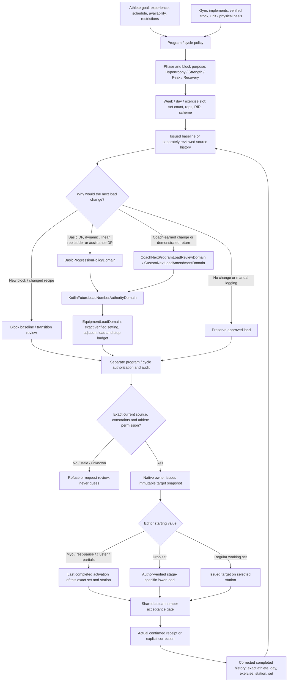

# Weight decision authority map — Kotlin rebuild

**Status:** source-traced architecture map and targeted numerical audit, 2026-11-23. This is not a full proof of every Android native caller or a claim of web parity. The authoritative records are the reviewed Kotlin code and native-store receipts. The diagram describes both implemented responsibilities and the acceptance boundaries that must exist before a candidate can become an issued workout.

## What “a weight” means

A weight is never an isolated decimal. It belongs to an athlete, a specific movement/variant, gym and physical machine (or no machine), unit, physical load basis, block, training day, exercise slot, set ordinal/type, phase, program revision and load scheme. Keep these values distinct:

| Number | Source | May change an issued target? |
| --- | --- | --- |
| **Authored / issued** | Approved program/cycle version and immutable workout snapshot | **No**, not after issuance |
| **Editor seed** | Issued set or the exact *completed activation* receipt for same-load amplifiers; authored stage for drops | No; editable UI starting value only |
| **Actual** | Athlete-verified performance and separate correction receipts | No; history is a fact, not a prescription |
| **Future candidate** | Baseline progression, conservative coaching, phase transition, or individually reviewed new-block policy | Not without owner, revision, consent and issuance checks |

“Target”, “Last”, “Actual”, and “Next suggestion” must never be substituted for one another.

## 1. Top-down influence and authority graph

**Graph reading:** not every arrow is an automatic write. Baseline progression and coaching return uncommitted candidates. Stock inspection is informational and never rounds a logged actual. New-block reviews and manual logging do not inherit permission to overwrite an existing workout. The native store, not Compose, authenticates snapshots and decides whether an accepted candidate may be persisted.

## 2. Ordered load-decision rules

1. **Identity and source:** current authenticated athlete, gym, program and cycle revision; training-day/weekday, movement variant, set ordinal, machine instance, physical basis and unit. Unknown machine or incompatible source is not the “closest” history.
2. **Approved prescription:** exercise, phase, block purpose, set scheme, ordered working sets, target reps/RIR, warmups and amplifier attachment; protected or athlete-pinned work remains protected.
3. **Evidence:** completed comparable issued-set receipts and corrections; never pretend skipped/failed/warmup/amplifier rounds are ordinary successful working sets. Actual RIR remains null when not reported; any policy assumption must be explicit.
4. **Chosen strategy:** manual repeats unchanged; basic strategy evaluates its own rep ceiling/floor and exact set ordinals; coaching may additionally consider real recovery evidence and reviewed boundaries. Basic strategies are not silently post-processed by fatigue coaching.
5. **Numerical approval:** shared `KotlinSetNumberAuthorityDomain.validPhysicalLoadValue` owns the physical decimal envelope. `KotlinFutureLoadNumberAuthorityDomain` owns future direction (including *decreasing assistance*), verified adjacency, bounded step and source kind. `EquipmentLoadDomain` owns implement-specific feasibility; it does **not** auto-round a candidate or actual.
6. **Authorization:** evaluate current restrictions, inventory, complete program/weekly volume and time feasibility, source revision, user permission and reviewed before/after diff. A suggestion is not permission to save; an old receipt is not permission to issue from a stale snapshot.
7. **Set execution:** immutable issued values -> editor seed -> athlete edit -> `KotlinSetNumberAuthorityDomain.review` -> factual journal and correction. An amplifier uses the **actual final attached activation**, not the first exercise set; drops are staged against the real prior performed drop.
8. **Next session:** query comparable corrected history using the complete scope again. A manually lowered actual, unsupported physical machine, unknown load unit or non-attained rep ceiling does not authorize a silent increase/decrease.

## 3. Existing source owners — audit inventory

| Responsibility | Primary Kotlin source | Must not be duplicated in |
| --- | --- | --- |
| Goal, exercise and calendar construction | `CoachAthleteProgramGenerator`, `CoachWeekComposer`, `CoachSessionPrescriptionDomain`, `CustomCycleBuilderDomain`, `GeneratedUpstreamNumberTraceDomain` | Native screens, history queries |
| Phase, dose and retention | `GeneratedAdaptiveBlockDomain`, `AdaptiveStrengthVolumeRepairDomain`, `WeeklyDoseFeasibilityDomain`, `CustomTrainingCycleDomain` | Load-rounding helper |
| Set/source identity and verified history | `KotlinWorkingSetEvidenceDomain`, `KotlinProgramPerformanceEvidenceDomain`, `WorkoutLastReferenceDomain`, `KotlinGlobalHistoryIndexDomain` | UI “Last” text and next-weight arithmetic |
| Basic progression strategy | `BasicProgressionPolicyDomain`, `CustomBasicHistoryProgressionDomain`, `BasicProgramProgressionPlanDomain` | Equipment inspector, journal |
| Coach and transition review | `CoachNextProgramLoadReviewDomain`, `CustomNextLoadAmendmentDomain`, `CustomBlockTransitionLoadDomain`, `CustomSameBlockLoadContinuityDomain` | Progression-independent patch in editor |
| One future physical-number gate | `KotlinFutureLoadNumberAuthorityDomain` | Each caller's own direction/rounding/precision table |
| Physical stock and nearest verified settings | `EquipmentLoadDomain` | A unit-only default increment or nearest-weight rounding |
| One actual/set-number acceptance gate | `KotlinSetNumberAuthorityDomain` | Custom/generated journal forks, amplifier UI |
| Technique stage / activation semantics | `AdvancedAmplifierProtocolDomain` | First-set or prior-session prefill fallback |
| Issuance, consent, editing and durable journal | Native authenticated owner, `KotlinWorkoutJournalDomain`, `CustomWorkoutJournalDomain` and native-store adapters | Pure candidate/review domains |

**Scope caveat:** mapping a source owner is not proof all Compose and store callers honor it. Treat this as an audit inventory and keep verifying actual call sites, program revision safety, and cold-reopen behavior.

## 4. Findings from this pass and fixes

| Finding | Risk | Resolution on this branch |
| --- | --- | --- |
| `EquipmentLoadDomain` independently declared the 100,000 maximum and three-decimal precision used for actual journal numbers | Stock inspection and logged actuals could diverge after a future change | Delegate both stock total and increment numeric envelope to `KotlinSetNumberAuthorityDomain.validPhysicalLoadValue`; stock mechanics remain separate |
| Same-load amplifier editor checked only that activation was positive, same-unit and same-station | A malformed precision, impossible reps or RIR could prefill follow-up UI despite shared journal rules | Reuse shared **completed-set** acceptance, retaining exact activation/station semantics |
| Drop-stage candidate and live completed drop checked reps, direction and station without reusing the full set-number envelope | Corrupt historical/prefill stages could appear structurally plausible | Validate activation, first performed drop and completed stage with shared set-number gate; authored drops also use shared prescribed-load envelope |
| Many distinct upstream inputs may legitimately affect future numbers | A single output decimal cannot explain a change | Keep provenance of scope, approved source, baseline, strategy, reason, stock, proposed value and acceptance state; do not manufacture it from the UI |

## November 23 continuation: preserve physical-number proof in Kotlin results

The shared `KotlinFutureLoadNumberAuthorityDomain` now returns a read-only
`KotlinFutureLoadPhysicalProof` **as part of the accepted numeric fact**.
It captures the exact inspected issued/candidate values, next verified higher
and lower settings, absolute change, and why the source was authorized:
ordinary adjacent increase, less machine assistance, or a checked lower
setting needing separate previously demonstrated performance. It never
converts that physical feasibility into proof of historical performance or
automatic permission to save or issue.

The pure `BasicProgressionPolicyDomain` forwards those **same accepted
physical facts** by stable working-set ordinal, together with the reviewed
`BasicProgressionScope` (athlete/program/gym/block/day/exercise/machine/unit/
basis). It retains *no* physical approval on a manually logged repeat,
rep-only change, ineligible dynamic set, failed stock limit, or strict/ladder
atomic rollback. Generated and custom coaching already carry a
`KotlinFutureLoadFact` through their review models, so this is shared proof,
not a second generated/custom calculation.

The proof reports what the physical gate verified and nothing more. The
native owner must independently recheck source revision, comparable
performance, permissions and full-program constraints before any future
workout revision can be issued. UI "Why this?" views should **render the
captured proof**, not call equipment inspection again or synthesize a new
number after the accepted review. The next integration pass must carry it
through authenticated owner acceptance, saved proposed revisions and both
live workload presenters with cold-reopen tests.

## November 23 native preview and week-edit handoff

The signed custom next-week **basic progression preview** and its
`CustomBasicProgressionDraftDomain.reviewedSets` / `forWeekEdit` source
adapter now consume the same per-set facts that the evaluator already
accepted. A load-changing row cannot appear in the preview or become a
week-edit draft without:

- An **exactly matching** `approvedFutureLoadFacts` set by working ordinal;
  unchanged and rep-only rows have no speculative load approval.
- A valid reviewed `sourceScope` that matches the active block, training-day
  identity, selected machine instance, load unit and physical basis.
- Equal issued and proposed numbers in the approved fact and its physical
  proof, the true absolute difference within the verified increment limit,
  and the correct verified adjacent setting for ordinary load increases
  versus **lower assistance counterweights**.
- No attempt to use the independently reviewed *return to demonstrated load*
  as an earned basic double-progression increase.

The Compose read-only preview now displays the engine's accepted change
magnitude and verified next equipment setting per changed set, rather than
inventing an increment from the UI's rep ceiling or exercise labels.
Tests cover real verified 20 → 25 per-hand loads, assistance 70 → 65,
zero-added landmine 0 → 25, and forged missing/mismatched proof, machine,
weekday, source and held-set approvals.

**Boundary:** this is an authenticated-source *shape check and projection*,
not source authentication or consent. The native owner still must reopen
current history, gym and program revision and perform the full cycle/week
audit in its existing transaction before accepting or issuing any changed
workout. A cryptographically durable explanation record and future
accepted-review cold-replay proof are still open.

## November 23: accepted future-week physical-number replay

The **activated custom future-week load path** now uses the existing shared
`KotlinFutureLoadNumberAuthorityDomain.review` instead of independent
"physically next" calculations in both `NativeKotlinCustomFutureWeekLoadOptionReview`
and `NativeFutureWeekLoadSessionProjection`.

The earning reviewer retains `KotlinFutureLoadFact` in its read-only
`NativeFutureWeekLoadOptionResult.Ready`. After durable athlete consent,
the projection **reopens the current verified inventory** and rederives
the same fact. The owner-fenced
`NativeKotlinAcceptedFutureWeekLoadHandoff` refuses the projected workout
unless both rederivations match exactly, the observed signed original and
consented previous/proposed numbers match, and the source is an ordinary
earned adjacent increase (not recovery or reversed assistance). Its
`Ready.numberFact` is a read-only audit receipt, never an issuance grant.

New JVM tests include numeric/basis/stock divergence, "same displayed
weight but different physical proof" refusal, and **cold reopening** the
existing durable athlete consent using a new file-store/fence instance.
A changed history watermark, removed equipment step and revoked consent
cannot turn into a successful projection after reopening.

This deliberately does **not** skip the athlete's explicit review, create
an already-issued workout, amend historical sets, persist unverified UI
labels, or silently change a saved cycle. The durable consent retains its
existing content-bound fingerprint and owner transaction; a later workout
issuer must separately authenticate its prepared-snapshot provenance
before issuance. The cold-reopen fixture uses an injected review offer
to isolate file integrity and projection; a full real owner-source
end-to-end issuance test remains separate.

## 5. Contract tests and continuing acceptance matrix

- `EquipmentLoadDomainTest`: valid and invalid decimal envelope agreed with `KotlinSetNumberAuthorityDomain`, plus malformed selector increment refusal.
- `AdvancedAmplifierProtocolDomainTest`: correct final attached activation across all myo stages; refuse invalid actual loads, rep counts, RIR, unit and machine; refuse malformed drop stages; no retroactive reweighting of actuals.
- Existing `BasicProgressionPolicyDomainTest`, `BasicProgressionExtendedCoverageTest` and `KotlinFutureLoadNumberAuthorityDomainTest`: exact set-ordinal DP vs dynamic; no forced increase, assisted direction, no phantom stock or unauthorized increments.
- Existing `GeneratedUpstreamNumberTraceDomainTest`, `CustomBlockTransitionLoadDomainTest`, `KotlinWorkoutJournalDomainTest`: review source progression, block recipes, issued-vs-actual separation.

**Additional work still required:** deterministic end-to-end replay of *all* generated and custom set choices across program → block/week/day/slot → historical baseline → proposal → consent → issued snapshot → live edit → corrected history. Add paired generated/custom/device evidence for Machine A/B, 3–6 day splits, different bench training days, phase boundaries, backoff/cluster/partial techniques, deloads, manual lowered loads and edited historical receipts. Verify all native UI entry paths use the correct owner. Do not claim total engine parity or certification from pure JUnit alone.

## 6. Rules for future code reviews

A change that can affect a displayed weight must identify (a) whether it is *authored target, prefill, actual or proposal*, (b) its authenticated scope and immutable input revision, (c) the responsible existing policy, (d) its explicit refusal/override rule, (e) any precise physical inventory and direction rule, (f) its recorded reason and actor permission, and (g) the JUnit + owner/cold-reopen or UI contract that proves the path. Never add a second scalar “suggestedWeight” mutation in a presenter to bypass these gates.

See also [Training-number authority](TRAINING_NUMBER_AUTHORITY.md), [Basic progression foundation](../kotlin-engine/BASIC_PROGRESSION_FOUNDATION.md), and [next-load/cycle continuity](../kotlin-engine/NEXT_LOAD_AND_CYCLE_CONTINUITY_GATE.md).
